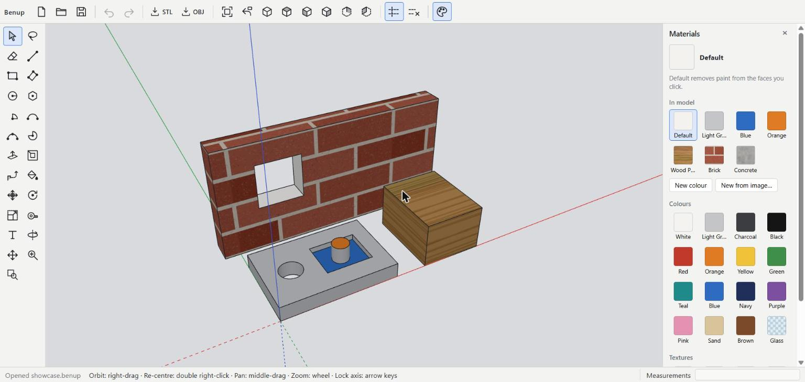

# VormCraft

**A free, fast, direct 3D modeler: draw a shape, grab a face, push it.**

VormCraft is a push/pull 3D modeling program for woodworking, architecture sketches, 3D printing and CAD/CAM handoff. There is no parametric timeline and no constraint solver. You draw on faces, push and pull them, and the model follows. It works much like SketchUp, but it is free and open source.



> **Status:** early (v0.1) and under active development. The modeling core is solid and well tested. New features are added as the program gets used. A Windows 11 installer will be published on the [Releases](../../releases) page. Until then, run it from source (see below).

---

## Features

### Drawing
- **Line**, **Rectangle**, **Rotated Rectangle**, **Circle**, **Polygon**, **2-Point Arc**, **3-Point Arc**, **Arc**, **Pie**
- Draw on any face, or on the ground. New edges split the face they are drawn on automatically.
- Every tool takes typed input. Type a length, `width,length` or a radius and press Enter, for example `1200,600`, `2.5m`, `3'6"`. Lengths are in millimetres by default; cm, m, in and ft are also accepted.

### Modeling
- **Push/Pull**: extrude a face out to add material, or in to remove it.
  - Push a shape flush to the far side and you get a clean through-hole.
  - Push through a solid whose far side isn't flush and it is cut with a real boolean operation. No manual "intersect faces" step is needed.
  - Double-click a face to repeat the last distance.
- **Offset**: copy a face's outline inward or outward, or offset a chain of edges.
- **Follow Me**: sweep a profile along a path, for mouldings, pipes, grooves, chamfers and lathed (turned) shapes.
- **Move** and **Rotate**: tap Ctrl to make copies, then type a count (`5x` or `/5`) to make arrays. **Scale** resizes selected geometry.
- **Eraser**, **Tape Measure** (measure, place guides, rescale the model) and **Text** labels.
- Curves keep their true radius, so circles and arcs export smoothly at any resolution.

### Groups
- Select geometry and press **Ctrl+G** to make a group. A group keeps its geometry to itself, so it never sticks to or merges with anything it touches, and groups can hold other groups.
- A group selects, moves, rotates, scales, copies and paints as one piece.
- Double-click a group to edit what's inside it; the rest of the model fades while you work. Press Esc (or click outside it) to close it.
- **Explode Group** (in the Search box, Shift+S) turns a group back into loose geometry.

### Inference snapping
- Snaps to endpoints, midpoints, edges, faces, guide intersections and the red, green and blue axes, with a visual cue for each.
- Arrow keys lock to an axis (→ red, ← green, ↑ blue, ↓ parallel or perpendicular to the last edge).

### Scenes and view styles
- **Scenes** save a view: the camera, which groups are hidden, and the display style. Tabs along the top of the viewport jump between them with a smooth camera glide, and **Play** runs them as a looping slideshow.
- Choose per scene what it restores (camera, hidden groups, style), overwrite a scene with **Update**, and rename or reorder scenes in the Scenes panel.
- Display styles: **Textured**, **Shaded**, **Wireframe** and **X-ray**, plus back edges and a background colour.
- **Perspective** or **parallel** projection.
- Hide selected groups and unhide them all (from the Search box).

### Materials
- **Paint Bucket**: plain colours, see-through colours such as glass, or tiled textures at real-world size.
- Built-in library of colours and textures (brick, wood planks, tiles, concrete, grass), or use your own image.
- Paint follows the geometry: split, pushed and moved faces keep their paint.

### Files and export
- Saves to its own `.vorm` file format. Older files keep opening as the format evolves, including `.benup` files from before the rename.
- **STL** (binary) export with a watertight check and adjustable curve resolution, for 3D printing.
- **OBJ** export.
- Unlimited undo and redo.

### Navigation

| Action | Mouse |
| --- | --- |
| Use the active tool | Left button |
| Orbit | Right-drag (about the point under the cursor) |
| Re-centre the view | Double right-click |
| Pan | Middle-drag |
| Zoom | Mouse wheel (toward the cursor) |
| Zoom extents | Shift+Z |

Standard views (top, front, iso, …), Zoom Window, Previous View and back-edge display are available from the toolbar.

---

## Keyboard shortcuts

| Key | Tool | Key | Tool |
| --- | --- | --- | --- |
| Space | Select | Shift+Space | Lasso Select |
| L | Line | A | 2-Point Arc |
| R | Rectangle | Shift+A | Pie |
| Shift+R | Rotated Rectangle | P | Push/Pull |
| C | Circle | Shift+P | Follow Me |
| Shift+C | Polygon | F | Offset |
| M | Move | Q | Rotate |
| S | Scale | E | Eraser |
| T | Tape Measure | B | Paint Bucket |
| O / H / Z | Orbit / Pan / Zoom | Shift+W | Zoom Window |
| Shift+V | Previous View | K | Back Edges |
| Page Down / Page Up | Next / previous scene | | |
| Shift+S | Search commands | Ctrl+G | Make Group |
| Ctrl+Z / Ctrl+Y | Undo / Redo | | |
| Ctrl+N / O / S | New / Open / Save | Ctrl+Shift+S | Save As |

---

## Running from source

You need [Node.js](https://nodejs.org/) 20.19+ or 22.12+.

```bash
git clone https://github.com/dobbsbp/VormCraft.git
cd VormCraft
npm install
npm run dev          # then open the address it prints (http://localhost:5173)
```

Other commands:

```bash
npm test             # run the test suite (Vitest)
npm run typecheck    # TypeScript strict type check
npm run build        # type check + production web build in dist/
```

### Desktop app (Windows)

The desktop version uses [Tauri](https://tauri.app/) and needs the [Rust toolchain](https://www.rust-lang.org/tools/install) as well as Node.js.

```bash
npm run desktop:dev      # desktop window against the dev server
npm run desktop:build    # installer in src-tauri/target/release/bundle/nsis/
```

---

## How it works

VormCraft's own geometry kernel is the source of truth. The 3D view only displays it.

| Folder | What's in it |
| --- | --- |
| `src/core` | The geometry kernel: a half-edge boundary representation with true polygon faces and holes, modeling operations (push/pull, offset, follow me, imprinting, cleanup), booleans through [Manifold](https://github.com/elalish/manifold), and watertight checks. Plain TypeScript with no graphics, so it is fully testable. |
| `src/view` | [Three.js](https://threejs.org/) display: triangulation for drawing, picking that maps every triangle and line back to its model face or edge, camera navigation. |
| `src/tools` | Every tool as a plain state machine, plus the inference/snapping engine and the controller that turns each operation into one atomic, undoable step. |
| `src/doc` | The document (model, guides, labels, materials), snapshots and undo history. |
| `src/io` | The `.vorm` file format, STL and OBJ export, and tessellation of curved surfaces from their true radii. |
| `src/app` | The app shell: toolbar, panels, dialogs, icons. |
| `src-tauri` | The Tauri desktop shell (native file dialogs and file access). |
| `tests` | Vitest tests covering the kernel, tools, snapping, file format and display data. |

Units are millimetres, and Z is up (red = X, green = Y, blue = Z). The full design spec is in [docs/SPEC.md](docs/SPEC.md).

---

## Roadmap

Features are added as real use calls for them. Ideas on the list:

- Windows 11 installer on the Releases page
- Dimensions, Section Planes, tags/layers, shadows (scenes will save these too)
- Components (reusable, linked copies)
- STEP export (true curves, through OpenCascade)
- Exporting materials with OBJ

Bug reports and suggestions are welcome in [Issues](../../issues).

---

## License

[MIT](LICENSE). Free to use, change and share, including commercially.

VormCraft is an independent project and is not affiliated with or endorsed by Trimble or SketchUp.
