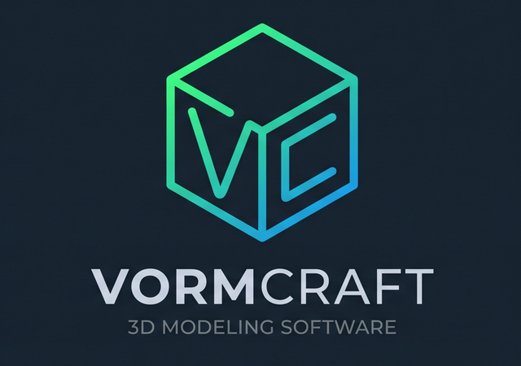
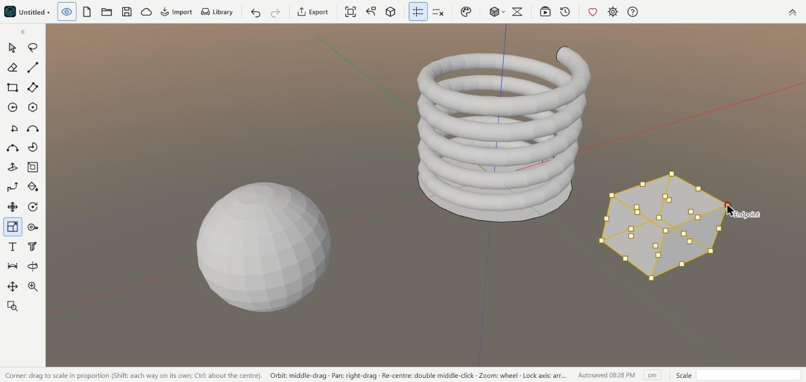
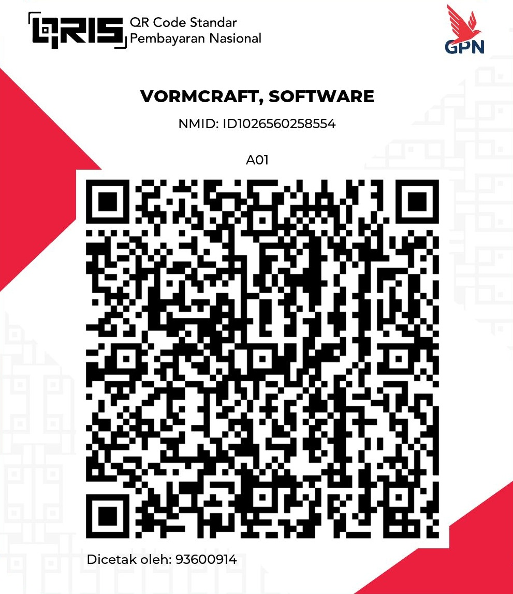

<p align="center"></p>

# VormCraft

**A free, fast, direct 3D modeler: draw a shape, grab a face, push it.**

VormCraft is a push/pull 3D modeling program for woodworking, architecture sketches, 3D printing and CAD/CAM handoff. There is no parametric timeline and no constraint solver. You draw on faces, push and pull them, and the model follows. It works much like SketchUp, but it is free and open source. It runs on Windows, on Linux and in the browser.



*A spring (Follow Me round a circle, then `5, 30cm` typed for 5 turns climbing 30 cm each), a sphere (an upright circle on the centre of a flat one), and the Scale tool's grips on a box.*

> **Status:** early and under active development. The modeling core is solid and well tested, and new features are added as the program gets used.

## Download

**Windows:** get the installer (`VormCraft_x.y.z_x64-setup.exe`) from the [Releases](../../releases) page. It installs for your user account (no administrator rights needed) and makes `.vorm` files open with a double-click. Windows 11 has everything it needs; on Windows 10 the installer fetches Microsoft's WebView2 if it is missing.

The installer is not code-signed yet, so the first time Windows may say "Windows protected your PC": click **More info → Run anyway**.

VormCraft checks for a new version when it starts and installs it with one click (**Install and restart**). You can also use **Check for Updates** in the Help menu (the ? button).

**Linux:** get the AppImage for your computer from the [Releases](../../releases) page: `VormCraft_x.y.z_amd64.AppImage` for most PCs (Intel and AMD), or `VormCraft_x.y.z_aarch64.AppImage` for ARM computers such as a Raspberry Pi 5 (64-bit Raspberry Pi OS) or an ARM laptop. Linux builds are new since 0.6.0, so feedback in [Issues](../../issues) is very welcome. It needs a 64-bit system from 2022 or later (for example Ubuntu 22.04, Debian 12, Fedora 36 or newer).

```bash
chmod +x VormCraft_*.AppImage
./VormCraft_*.AppImage
```

- Keep the AppImage in a folder you can change, such as your home folder or `~/Applications`: VormCraft updates itself by replacing that file, like the Windows app (**Install and restart**).
- If it does not start on Ubuntu 24.04 or newer, install FUSE 2 (`sudo apt install libfuse2t64`), or run it with `--appimage-extract-and-run`.
- To have `.vorm` files open with a double-click and VormCraft in your applications menu, add the AppImage with [Gear Lever](https://flathub.org/apps/it.mijorus.gearlever) or AppImageLauncher.
- Google Drive's sign-in is kept in your keyring (GNOME Keyring or KWallet). Without one, you sign in again each time VormCraft starts.
- The system chooses the graphics card; the Windows app's Graphics card setting is not on Linux yet. **About VormCraft** shows which chip is drawing (and any other in the computer). On Pop!_OS, for example, that follows the graphics mode you choose in the system menu.

**Everywhere else (Android tablets and folding phones, Chromebooks, Mac):** open **https://vormcraft.app** in Chrome or Edge and choose **Install** (Chrome menu → *Add to home screen* / *Install app*). It then opens in its own window like any app, works fully offline, and updates itself, asking before it restarts into a new version. Your models stay on your device (or in your own Google Drive, if you connect it). A keyboard and mouse are recommended for modeling; on a phone or tablet, tap **Viewer** (the eye) to look around a model with touch. In the web version, Save downloads the `.vorm` file (instead of saving over it), and autosave copies are kept in the app's own storage.

All versions have the same version number and open the same `.vorm` files.

---

## Features

### Drawing
- **Line**, **Rectangle**, **Rotated Rectangle**, **Circle**, **Polygon**, **2-Point Arc**, **3-Point Arc**, **Arc**, **Pie**
- Draw on any face, or on the ground. New edges split the face they are drawn on automatically.
- **Rectangle** stands upright when you snap its second corner to a point above or beside the first; the arrow keys fix its plane (→ faces red, ← faces green, ↑ flat).
- Deleted a face? Draw a line over one of the opening's edges and it closes again.
- The mouse pointer shows the active tool's icon, with a small triangle at its top-left tip marking the exact click point.
- The tool icons can be tucked away into a narrow tab (the bar above them) for more room; click the tab to bring them back.
- Every tool takes typed input. Type a length, `width,length` or a radius and press Enter, for example `1200,600`, `2.5m`, `3'6"`. Lengths are in millimetres by default; cm, m, in and ft are also accepted.
- **Circle**: click the centre, type the number of sides and press Enter (or just Enter for 24), then type the radius and press Enter. Or click to set the radius.
- **Arc** and **Pie**: click the centre, click the start or type the radius and press Enter, type the number of segments and press Enter (or just Enter for 12), then type the angle in degrees (360 makes a full circle) or click the end.

### Modeling
- **Push/Pull**: extrude a face out to add material, or in to remove it. Push a rectangle drawn on a wall in as far as the wall is thick (or further) to cut a window or doorway through it.
  - Push a shape flush to the far side and you get a clean through-hole.
  - Push through a solid whose far side isn't flush and it is cut with a real boolean operation. No manual "intersect faces" step is needed.
  - Double-click a face to repeat the last distance.
  - Push a face level with the face next to it and they merge into one (hold Ctrl to keep the edge). Pushing a bump back down shortens its sides instead of leaving overlapping faces.
- **Offset**: copy a face's outline inward or outward, or offset a chain of edges.
- **Follow Me**: sweep a profile along a path, for rings, spheres, domes, bowls, pipes and elbows, picture frames, rounded edges, grooves and other lathed (turned) shapes. Select the path first, then click the profile; stand a circle upright for it with the arrow keys while drawing (→ or ←). For a sphere, draw a flat circle, draw an upright circle on its centre, select the flat one and click the upright one. For a spring or coil, make a ring, then type the turns and the rise per turn (`5, 40mm`; add a third number to widen each turn); the **Spiral tips** button at the bottom of the window explains it step by step. Mistakes, such as picking them the wrong way round, are explained instead of making a broken shape.
- **Rotate** shows a protractor with the angle in degrees; the arrow keys pick its axis, and ↓ turns about any line you last pointed at, whatever its angle. **Circle** and **Polygon** stand upright with → and ←, and square across a sloping line with ↓.
- **Move**, **Rotate** and **Scale** snap to the centre of a face (a small × near its middle, on flat, upright or sloping faces alike), so shapes move centre to centre and turn about their middle.
- **Move** and **Rotate**: press Ctrl to copy instead (a + shows on the cursor and the copy follows the mouse; copy mode ends with the copy), then type a count (`5x` or `/5`) to make arrays. **Push/Pull** with Ctrl makes a new starting face: an edge loop stays where the face was, so the new sides are separate faces (stacking floors, for example). **Scale** shows a yellow box with grips round the selection: drag a corner to resize in proportion, the middle of a side to stretch one way (Shift: each way on its own; Ctrl: about the centre); negative factors mirror.
- **Points**: click where two or more lines meet to select that corner, then Move, Rotate or Scale it; the faces around it stretch (or fold) to follow. The arrow keys lock the axis.
- **Merge Shapes** (right-click): overlapping flat faces in one plane become one face; for solids and groups, choose **Unify** (one solid, with the faces inside removed) or **Keep shapes** (put together in one group, unchanged). Flat faces selected along with solids (such as the circle left inside a Follow Me ring) are left as they are, and if a merge isn't possible it says why.
- **Wall**: click along the floor to draw walls (or type each length), and click the first corner to close a room. Type `thickness, height` (`150, 2700`); Ctrl puts the walls centred on the line, to its left or to its right. The walls come out as one closed solid in a group.
- **Section Plane**: click a face to cut the model there and look inside (click the ground for a level cut), then type a distance to move the cut. The cut is outlined and filled. Drag a plane's outline with the tool to slide it along, and the cut follows as you drag (it snaps to points, or type how far); Move slides a plane straight along too, and Rotate turns it. **Section tips** in the status bar explain placing, moving and removing cuts. Click a plane's outline to select it (Delete removes it, as does the Eraser); right-click it to reverse the cut, turn it off or hide the planes. Scenes remember the cut.
- **Eraser**, **Tape Measure** (measure, place guides, rescale the model) and **Text** labels (Delete, the Eraser, a box or right-click erases them; drag to move, double-click to edit).
- **Dimension**: click a line (or two points) and pull out to show its length end to end, with dashed extension lines and arrows. Drag the value to move it further out; double-click it to type your own text.
- **Units** per design: millimetres, centimetres, metres, inches, feet, or feet and inches (3' 6 1/2"). New asks which; click the design's name to change them. A number typed without a unit means the design's unit.
- **3D Text**: type words, pick one of your computer's fonts, the letter height and depth, and place them as solid letters, standing up or lying flat.
- **Reverse Faces**, **Flip Along** red/green/blue, and **Soften/Unsoften Edges** (from the right-click menu).
- Curves keep their true radius, so circles and arcs export smoothly at any resolution.

### Library
- **Library** (toolbar): 57 objects made for VormCraft at real-world sizes: furniture, kitchen units and appliances, bathroom fittings, electronics, lighting, decor, and doors and windows.
- Search by name or other words ("couch", "fridge", "telly"; typos are fine), narrow by room or kind, and pick a size (beds from Single to King, TVs from 43" to 75", kitchen units 300 to 900 mm wide).
- **Customise…** makes an item to your own sizes: most furniture (with the number of drawers, doors, shelves or seats), kitchen units, bathroom fittings, TVs and monitors by screen size, rugs, frames, doors and windows (the opening in the wall follows), a phone stand made to fit your phone (thickness, height, angle, a slot for the cable), and a light fixture as a box, tapered box, cylinder, cone or dome. A picture and the size follow what you type.
- **Design with AI** (Library, Search): describe what you want and copy the instructions into any AI chat; paste its answer into **Import AI design** and VormCraft checks it, shows it and places it. Problems are listed with where they are, ready to copy back to the AI. Designs can have settings to change with Customise…. VormCraft itself sends nothing anywhere.
- Click an object, then click in the model to place it; arrow keys turn it first. Each object comes in as a component (linked copies) with a group for each paint, so parts are easy to recolour. Wall items come in at their usual height, and pendant lights hang from the point you click.
- **Doors and windows**: point at a wall and click. The door or window faces out of the wall, sits in the middle of it, and cuts its own opening right through.

### Groups
- Select geometry and press **Ctrl+G** to make a group. A group keeps its geometry to itself, so it never sticks to or merges with anything it touches, and groups can hold other groups.
- A group selects, moves, rotates, scales, copies, flips and paints as one piece.
- Double-click a group to edit what's inside it; the rest of the model fades while you work. Press Esc (or click outside it) to close it.
- **Components** (right-click → Make Component): linked copies. Copy a component with Move or Rotate (Ctrl) and editing any copy changes them all, however each is turned, sized or mirrored. **Make Unique** unlinks a copy. A component is saved once in the file, however many copies there are.
- **Explode** turns a group back into loose geometry; **Hide** and **Unhide All** hide and show groups.
- **Hide lines**: select lines (or faces, for the lines between them) and press **Ctrl+H** to stop them being drawn; the faces stay as they are. While anything is hidden, the status bar shows **Show** (draws hidden lines dashed, so you can select a few and right-click → **Unhide**) and **Unhide all**.
- Rename groups and see their size and contents in **Entity Info**.

### Right-click menu
Right-click anything to select it and get a menu for it:
- **Entity Info**: a panel with a group's name (editable), contents, size and paint; faces' area and paint; edges' length and smoothing; the **volume** of solids and groups (listed one by one for up to five, with the total); and whether a shape is a proper **Solid** (or not closed, inside out, or pressed against another), with a button to select its open edges.
- **Erase**, **Hide** (lines or groups, Ctrl+H), **Unhide All** (Ctrl+Shift+H)
- **Edit Group**, **Close Group**, **Explode**, **Make Group**, **Merge Shapes…**
- **Select ▸** bounding edges, connected faces, all connected, all with the same material, all, none. Triple-click a line or face to select everything joined to it, loose lines included.
- **Reverse Faces**, **Flip Along ▸** red/green/blue, **Soften / Unsoften Edges**, **Zoom Selection**

### Viewer mode (phones, foldables and tablets)
- Tap **Viewer** (the eye, next to the logo) to put the tools away and just look at the model. **Exit viewer** in the corner brings them back (or press Esc).
- **One finger** pans. **Two fingers** do two things at once: pinch to zoom, and move them together to orbit. A flick keeps the view gliding; a double-tap centres on the point you tapped.
- The corner bar also has **Zoom to fit**, **Open**, **Google Drive** and a gear to lower the drawing resolution if moving the model is slow on your device.
- With a mouse, Viewer mode keeps the usual middle-drag orbit, right-drag pan and wheel zoom.

### Scenes and view styles
- **Scenes** save a view: the camera, which groups are hidden, and the display style. Tabs along the top of the viewport jump between them with a smooth camera glide; **Page Down / Page Up** step through them.
- **Play** runs the scenes as a looping slideshow, with adjustable transition and pause times.
- Choose per scene what it restores (camera, hidden groups, style), overwrite a scene with **Update**, and rename, reorder or delete scenes in the Scenes panel.
- Display styles: **Textured**, **Shaded**, **Wireframe** and **X-ray** (one toolbar button with a menu), plus back edges and a background colour. The standard views (Iso, Top, Front, Right, Back, Left) are one button: each click goes to the next view, and right-click lists them all.
- **Sky and ground** behind the model (Style menu): a clear or softly clouded sky, over plain, grass, paving or sand ground, or a plain colour. Presets: Day, Soft clouds, Evening, Plain. Kept on each device; scenes can keep their own.
- **Perspective** or **parallel** projection.

### Materials
- **Paint Bucket**: plain colours, see-through colours such as glass, or tiled textures at real-world size.
- A floating Materials window with tabs for the materials in the model, colours (neutrals, warm, cool, see-through) and textures (wood, stone and brick, ground, metal and fabric), or use your own image.
- Paint follows the geometry: split, pushed and moved faces keep their paint. Painting a group colours all of its unpainted faces.

### Inference snapping
- Snaps to endpoints, midpoints, edges, faces, guide intersections and the red, green and blue axes, with a visual cue for each. Groups' corners and edges snap too.
- Arrow keys lock to an axis (→ red, ← green, ↑ blue, ↓ parallel or perpendicular to the last edge). With the arc tools they choose the plane the arc is drawn on instead (↑ flat, → and ← upright, facing red or green).

### Autosave and history
- **Autosave** every minute (when something changed) to a backup folder. Your own file only changes when you save. If VormCraft closes without saving, it offers your work back next time.
- **History:** every design keeps its earlier versions (recorded at each autosave and save, compressed, inside the `.vorm` file). Open **History**, click a version to look at it, then **Restore this version** or go **Back to now**. Restoring never loses anything: what you had stays in the list, and Undo works too.
- Older versions are thinned out over time (everything from the last day, one per hour for a week, then one per day) and the history has a size limit.
- **Undo after reopening:** the last 100 undo steps are saved in the file too, so Ctrl+Z still goes back after you close and reopen a design. Each step stores only what changed, so 100 steps usually add well under a megabyte.
- **Save a Copy Without History** for sending a design to someone (it leaves out the undo steps too).
- **Files from every version open:** `.vorm` files saved by earlier versions always open, and the first save over one keeps the original beside it. Files from a later version open too when they allow it (VormCraft says what it left out), or VormCraft offers the update.
- **Settings** (gear button): autosave on/off and how often, the backup folder, how long unrecovered backups are kept, history on/off and its size limit, the graphics card (Windows), update checks.

### Google Drive (optional)
- Save and open designs in your own Google Drive (the cloud button), from the web version and the desktop app, and optionally keep an autosaved copy there.
- **Folders:** keep designs in folders inside the VormCraft folder, as deep as you like. Open and Save show a folder browser with a path at the top (VormCraft › Kitchen › Cabinets): double-click a folder to go in, click the path or press Backspace to go back. **New folder** makes one. Each design and folder has a ⋯ button (or right-click) for **Rename**, **Move to…** and **Delete** (to the Google Drive bin; a folder with designs in it asks twice). Save As starts in the open design's folder; a name already in the folder asks whether to replace it or keep both.
- **All designs** (in Open): every design in your Drive that VormCraft saved, newest first, with the folder each is in, and a search box. It finds designs moved elsewhere on the Google Drive website too. Folders made on the Google Drive website don't show in VormCraft (it can only see what it made), so make folders with New folder.
- Save each device's settings (sky and ground, tools, units, autosave and so on) to Drive under a name, and load them back, or onto a new computer. Each device keeps its own.
- VormCraft asks only for access to the files it creates or that you open with it, never the rest of your Drive. Saving checks first whether the file was changed elsewhere (Replace or Keep both).
- Works with any Google account: VormCraft is verified by Google.

### Graphics and help
- Uses the graphics card through WebGL (Direct3D 11 on Windows, WebKitGTK on Linux). On laptops with two graphics chips, the Windows app uses the faster one by default; **Settings → Graphics card** switches between High performance, Power saving and Let Windows decide. If a computer can only draw without the graphics card, VormCraft says so.
- In the web version, Windows chooses the graphics card for the whole browser, usually the built-in one. When VormCraft runs on built-in graphics there, it shows once how to give the browser the faster card (Windows Settings → System → Display → Graphics → High performance); Settings → Graphics card shows the same steps.
- **Help** (the ? button): Keyboard and Mouse reference (also **F1**), What's New, Check for Updates, Report a Problem or Idea, and About (version and graphics card in use).

### Files and export
- Saves to its own `.vorm` file format, including groups, materials, scenes and history. Files from every earlier version keep opening (each format version is tested), including `.benup` files from before the rename. The first save over an older-format file keeps a backup of the original.
- **Import SketchUp (.skp) files** (Ctrl+I, or the Import button). The file comes in as a group, with its groups and components inside it as groups of their own (each placement of a SketchUp component becomes its own copy; they do not come in as linked components yet), keeping faces and holes, true circles and arcs, soft edges, paint (colours, transparency and textures at their real size), and, if you choose, its scenes and guides. If a file is very large because a small part is placed thousands of times (tiles, say), the import offers to leave those parts out, and it refuses models too large to hold instead of crashing. Faces that SketchUp allows but VormCraft's solids do not are turned round or kept on edges of their own, and the import reports how many. Files are read by [OpenSKP](https://github.com/iamahsanmehmood/openskp), an independent open-source reader; SketchUp 2018 and later read well, some older files cannot be read yet.
- **Import DXF drawings** (Ctrl+I, or the Import button), from AutoCAD, Rhino, Fusion, LibreCAD and other CAD programs. Curves come in at the detail you choose: circles and arcs (including ones written as splines, as Rhino's Make2D does) become true circles with the number of segments you pick, and other curves (splines, ellipses) are divided until they are within the gap you allow (0.05 mm to start with), with a live count of the edges it makes. The units come from the file. Each layer becomes a group inside one group for the drawing; you choose the layers (hidden-line layers and layers switched off in the file start unticked). Closed outlines become faces, with holes where shapes sit inside others (even on another layer), ready to push and pull; 3D wireframes that close become solids. Blocks are placed (moved, turned, scaled, mirrored, in arrays), texts become labels and dimensions become VormCraft dimensions. Hatches, images and 3D solids are left out and counted. DWG files need saving as DXF first.
- **Import OBJ and STL** (Ctrl+I, or the Import button). Each object comes in as a group; flat areas are joined back into single faces (a triangulated box becomes six faces you can push and pull) and curved surfaces are smoothed. You choose the file's units (with a live size preview) and whether Y or Z is up. Broken or duplicate triangles are left out and counted.
- **Export** (one toolbar button): **STL** (binary) with a watertight check and adjustable curve resolution, for 3D printing, or **OBJ** for other 3D programs.
- Unlimited undo and redo.
- **Search** (Shift+S) finds any tool or command by name.

### Arranging the workspace
- Drag tools in the palette to put them in your own order; right-click the palette to move it to the right side or reset the order.
- Keep only the tools you use: right-click a tool → **Remove from Palette**, or **Customise Tools…** (with an **Essentials** preset). Tools you leave out still work from their keys and Search, and are one click away under **⋯** at the end of the palette. New tools in later versions wait there for you (marked with a dot) instead of filling a palette you have trimmed.
- Hide the top bar for more room (the arrows at its right end); a small tab brings it back. The design's name shows next to the logo.

### Navigation

| Action | Mouse |
| --- | --- |
| Use the active tool | Left button |
| Context menu | Right-click |
| Orbit | Middle-drag (about the point under the cursor) |
| Re-centre the view | Double middle-click |
| Pan | Right-drag |
| Zoom | Mouse wheel (toward the cursor) |
| Zoom extents | Shift+Z |

In **Viewer mode** on a touch screen: one finger pans; two fingers pinch to zoom and move to orbit; double-tap re-centres.

Standard views (top, front, iso, …), Zoom Window, Previous View, display styles and projection are on the toolbar.

---

## Keyboard shortcuts

| Key | Tool | Key | Tool |
| --- | --- | --- | --- |
| Space | Select | Shift+Space | Lasso Select |
| L | Line | A | 2-Point Arc |
| R | Rectangle | Shift+A | Pie |
| Shift+R | Rotated Rectangle | P | Push/Pull |
| C | Circle | Shift+P | Follow Me |
| Shift+C | Polygon | F | Offset |
| M | Move | Q | Rotate |
| S | Scale | E | Eraser |
| T | Tape Measure | B | Paint Bucket |
| O / H / Z | Orbit / Pan / Zoom | Shift+W | Zoom Window |
| Shift+Z | Zoom Extents | Shift+V | Previous View |
| K | Back Edges | Shift+S | Search commands |
| Ctrl+G | Make Group | Esc | Cancel / clear selection / close group |
| Ctrl+I | Import SketchUp, OBJ, STL or DXF | Ctrl+A | Select everything in the model |
| Ctrl | Copy (Move, Rotate); new starting face (Push/Pull) | Ctrl+H / Ctrl+Shift+H | Hide selection / Unhide all |
| Delete | Erase selection | Page Down / Page Up | Next / previous scene |
| Ctrl+Z / Ctrl+Y | Undo / Redo | Ctrl+N / O / S | New / Open / Save |
| Ctrl+Shift+S | Save As | Esc | Leave an earlier version (History) |
| F1 | Keyboard and mouse reference | | |

---

## Running from source

You need [Node.js](https://nodejs.org/) 20.19+ or 22.12+.

```bash
git clone https://github.com/dobbsbp/VormCraft.git
cd VormCraft
npm install
npm run dev          # then open the address it prints (http://localhost:5173)
```

Other commands:

```bash
npm test             # run the test suite (Vitest)
npm run typecheck    # TypeScript strict type check
npm run build        # type check + production web build in dist/
```

### Desktop app (Windows and Linux)

The desktop version uses [Tauri](https://tauri.app/) and needs the [Rust toolchain](https://www.rust-lang.org/tools/install) as well as Node.js. On Linux it also needs WebKitGTK and a few other system libraries (on Ubuntu: `libwebkit2gtk-4.1-dev librsvg2-dev libssl-dev libdbus-1-dev patchelf`).

```bash
npm run desktop:dev                              # desktop window against the dev server
npm run desktop:build                            # Windows: installer in src-tauri/target/release/bundle/nsis/
npm run desktop:build -- --bundles appimage      # Linux: AppImage in src-tauri/target/release/bundle/appimage/
```

Releases are built by GitHub Actions when a version tag is pushed: see [docs/RELEASING.md](docs/RELEASING.md).

---

## How it works

VormCraft's own geometry kernel is the source of truth. The 3D view only displays it.

| Folder | What's in it |
| --- | --- |
| `src/core` | The geometry kernel: a half-edge boundary representation with true polygon faces and holes, modeling operations (push/pull, offset, follow me, imprinting, cleanup), booleans through [Manifold](https://github.com/elalish/manifold), and watertight checks. Plain TypeScript with no graphics, so it is fully testable. |
| `src/view` | [Three.js](https://threejs.org/) display: triangulation for drawing, picking that maps every triangle and line back to its model face or edge, display styles, camera navigation (perspective and parallel), and touch gestures for Viewer mode. |
| `src/tools` | Every tool as a plain state machine, plus the inference/snapping engine, the right-click menu, and the controller that turns each operation into one atomic, undoable step. |
| `src/doc` | The document (top-level geometry, groups, guides, labels, materials, scenes), snapshots and undo history. |
| `src/library` | The object library: every item built by code from boxes, cylinders and turned shapes at real sizes, plus its search. |
| `src/io` | The `.vorm` file format, STL and OBJ export, and tessellation of curved surfaces from their true radii. |
| `src/app` | The app shell: toolbar, panels (Materials, Scenes, Entity Info, History), context menu, dialogs, icons, Viewer mode, and Google Drive saving (`src/app/drive`). |
| `src-tauri` | The Tauri desktop shell: native file dialogs and file access, the updater, opening double-clicked `.vorm` files, and the graphics card choice. |
| `public`, `scripts/offline.ts` | The web app: its manifest and icons, the website's About, Privacy and Terms pages, and the build step that makes it work offline and update itself. |
| `tests` | Vitest tests covering the kernel, tools, groups, scenes, history, autosave, snapping, display data, and every file format version ever saved. |

Units are millimetres, and Z is up (red = X, green = Y, blue = Z). The full design spec is in [docs/SPEC.md](docs/SPEC.md).

---

## Roadmap

Features are added as real use calls for them. Ideas on the list:

- Tags/layers, sun and shadows (scenes will save these too)
- Settings that keep in step across devices by themselves (today you save and load them by hand)
- Components inside components, a list of the design's components, and locking groups
- Doors and windows that keep their opening when moved, and walls that join where they meet
- More Library categories (stairs and railings, office, outdoor) and saving your own items to the Library
- A field-of-view control
- STEP export (true curves, through OpenCascade)
- Exporting materials with OBJ
- Editing with touch (Viewer mode covers looking at models on phones and tablets today)
- A native Android app (if the web app's saving is not enough on phones and tablets)

Bug reports and suggestions are welcome in [Issues](../../issues).

---

## Support VormCraft

VormCraft is free and always will be. If it's useful to you, a small donation helps pay for the website and upkeep: **[Sponsor VormCraft on GitHub ♥](https://github.com/sponsors/dobbsbp)**. In the app, it's the heart on the toolbar, or Help → Support VormCraft.

In Indonesia you can also scan this QRIS code with any bank or e-wallet app:



## Contact and privacy

Questions, problems or ideas: open an [issue](../../issues) or email **info@vormcraft.app**. Your designs stay on your device or in your own Google Drive; see the [Privacy Policy](https://vormcraft.app/privacy/) and [Terms of Use](https://vormcraft.app/terms/).

## License

[MIT](LICENSE). Free to use, change and share, including commercially. VormCraft includes open-source libraries under their own licences: see [THIRD_PARTY_NOTICES.md](THIRD_PARTY_NOTICES.md).

VormCraft is an independent project and is not affiliated with or endorsed by Trimble or SketchUp.
